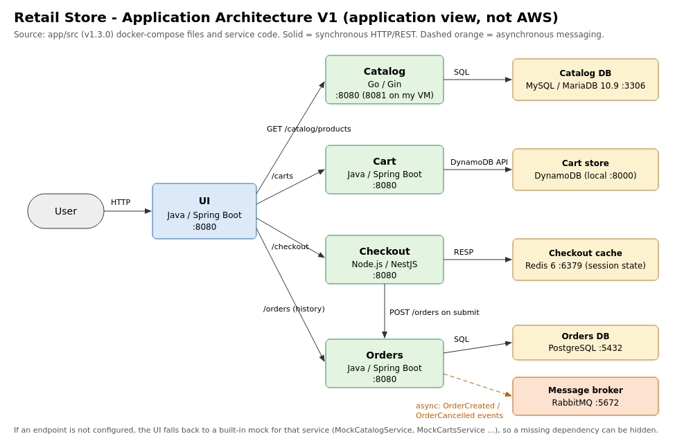

# Application Architecture V1

Diagram: [`diagrams/application-architecture-v1.png`](../diagrams/application-architecture-v1.png)
(source: `diagrams/application-architecture-v1.svg`, hand-drawn SVG).

This is the **application** view - which service talks to which, and with what.
AWS infrastructure (EKS, RDS, ...) is deliberately not in it yet.



```
User
 |  HTTP
 v
UI ----HTTP----> Catalog ----SQL----------> Catalog DB (MySQL/MariaDB)
 |
 +----HTTP----> Cart -------DynamoDB API--> Cart store (DynamoDB)
 |
 +----HTTP----> Checkout ---RESP----------> Redis (checkout session state)
 |                 |
 |                 +--HTTP POST /orders--+
 |                                       v
 +----HTTP----------------------------> Orders ----SQL----> Orders DB (PostgreSQL)
                                          |
                                          +- - async - -> RabbitMQ (OrderCreated / OrderCancelled events)
```

## Communication types

| Type | Where | How I know |
|---|---|---|
| **Synchronous HTTP/REST (JSON)** | UI->Catalog, UI->Cart, UI->Checkout, UI->Orders, Checkout->Orders | `RETAIL_UI_ENDPOINTS_*` and `RETAIL_CHECKOUT_ENDPOINTS_ORDERS` are `http://...` URLs; on my VM I saw the UI's GET requests in the Catalog access log |
| **Asynchronous messaging** | Orders -> RabbitMQ | `RETAIL_ORDERS_MESSAGING_PROVIDER=rabbitmq`; `OrderCreatedEvent` / `OrderCancelledEvent` classes in `orders/src/.../events/orders/` |
| **Database dependencies** | Catalog->MySQL, Cart->DynamoDB, Orders->PostgreSQL | compose files `catalog-db`, `carts-db`, `orders-db` |
| **Caching / session store** | Checkout -> Redis | `RETAIL_CHECKOUT_PERSISTENCE_PROVIDER=redis`; holds the checkout in progress, not the final order |
| **Built-in fallback** | UI -> Mock services | when an endpoint is empty the UI uses `MockCatalogService`, `MockCartsService`, ... |

## Why each service has its own datastore

Each service owns its data and others reach it only through the service's API. Catalog can change
its tables, or be scaled or restarted, without breaking Cart or Orders. The data also suits
different stores: products = relational reads, carts = key/value per customer, checkout =
short-lived session data, orders = relational and transactional.
