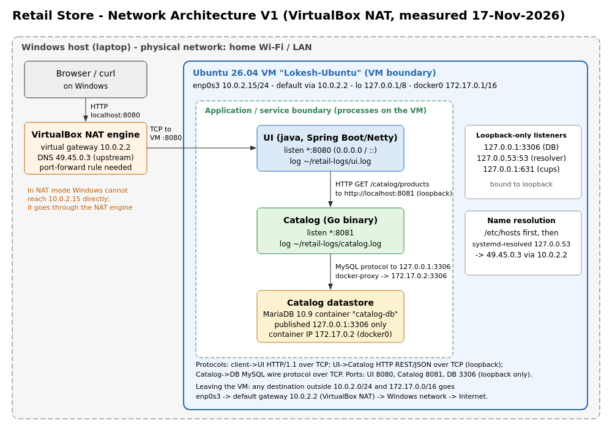

# Network Architecture V1

Diagram: [`diagrams/network-architecture-v1.png`](../diagrams/network-architecture-v1.png)
(source `diagrams/network-architecture-v1.svg`). All values were measured on 17-Nov-2026.



```
Windows host (laptop)                                       [physical network: home Wi-Fi / LAN]
  browser -> http://localhost:8080
     |  HTTP
     v
  VirtualBox NAT engine  (gateway 10.0.2.2, DNS relay, port-forward rule Host 8080 -> Guest 8080)
     |  TCP to 10.0.2.15:8080
=====|==================================== VM boundary =====================================
     v
Ubuntu VM "Lokesh-Ubuntu"   enp0s3 10.0.2.15/24, default via 10.0.2.2, lo 127.0.0.1, docker0 172.17.0.1
  ---------------------------- application / service boundary -----------------------------
  UI          java (Spring Boot / Netty)    listen *:8080       log ~/retail-logs/ui.log
     |  HTTP REST/JSON  GET /catalog/products   ->  http://localhost:8081   (loopback)
     v
  Catalog     Go binary                     listen *:8081       log ~/retail-logs/catalog.log
     |  MySQL protocol  ->  127.0.0.1:3306   (docker-proxy -> 172.17.0.2:3306 on docker0)
     v
  Catalog datastore   MariaDB 10.9 container "catalog-db"   published 127.0.0.1:3306 only
```

## Labels

| Element | Value |
|---|---|
| **IP addresses** | VM `10.0.2.15/24` (enp0s3); gateway `10.0.2.2`; loopback `127.0.0.1`; Docker bridge `172.17.0.1/16`; DB container `172.17.0.2` |
| **Ports** | UI 8080, Catalog 8081, Catalog DB 3306 (loopback only). Internal: resolver 53 (127.0.0.53) |
| **Protocols** | client -> UI: HTTP/1.1 over TCP. UI -> Catalog: HTTP REST + JSON over TCP (loopback). Catalog -> DB: MySQL wire protocol over TCP. Name lookups: DNS over UDP 53 via systemd-resolved |
| **VM boundary** | Between the Windows host / VirtualBox NAT engine and `enp0s3`. In NAT mode only port-forward rules cross it inbound |
| **Application / service boundary** | The three processes on the VM. UI is the only one meant to be reached from outside. Catalog listens on all addresses (`*:8081`) - it could be restricted. The DB is loopback-only |

## Walk-through (what I say in the review)
1. On Windows the browser opens `http://localhost:8080`. VirtualBox's NAT port-forward rule takes
   Windows port 8080 and sends the connection to the VM at `10.0.2.15:8080`.
   *(Rule still to be confirmed on the Windows side - see incident 05.)*
2. Inside the VM the packet arrives on `enp0s3`. The UI accepts it because it is bound to `0.0.0.0`
   (`*:8080`). Bound to `127.0.0.1` it would be refused (incident 05).
3. To render the page the UI makes three HTTP GETs to Catalog at `http://localhost:8081`. This
   traffic never leaves the VM (loopback). The UI finds Catalog only through `RETAIL_UI_ENDPOINTS_CATALOG`.
4. Catalog queries MariaDB at `127.0.0.1:3306`. docker-proxy forwards that to the container
   `172.17.0.2:3306` on the `docker0` bridge.
5. The answers flow back the same way: DB -> Catalog (JSON) -> UI (HTML) -> NAT -> Windows browser.
6. Outbound traffic from the VM (e.g. `github.com`) uses the default route `via 10.0.2.2 dev enp0s3`,
   and names are resolved by systemd-resolved (127.0.0.53) forwarding to 49.45.0.3.

## Where it can break (and which incident shows it)

| Layer | Failure | Seen in |
|---|---|---|
| Windows -> VM | NAT mode without a port-forward / firewall | incident 05 (to verify on Windows) |
| Bind address | UI on 127.0.0.1 | incident 05 |
| Port | wrong port / port already in use | incidents 02, 04 |
| Process | Catalog stopped | incidents 01, 06-A |
| DNS | wrong hostname `catalog` | incident 06-C |
| Configuration | wrong / empty endpoint | incident 06-B, 06-D |
| Resources | CPU saturation, disk full | `linux-troubleshooting.md`, incident 03 |
